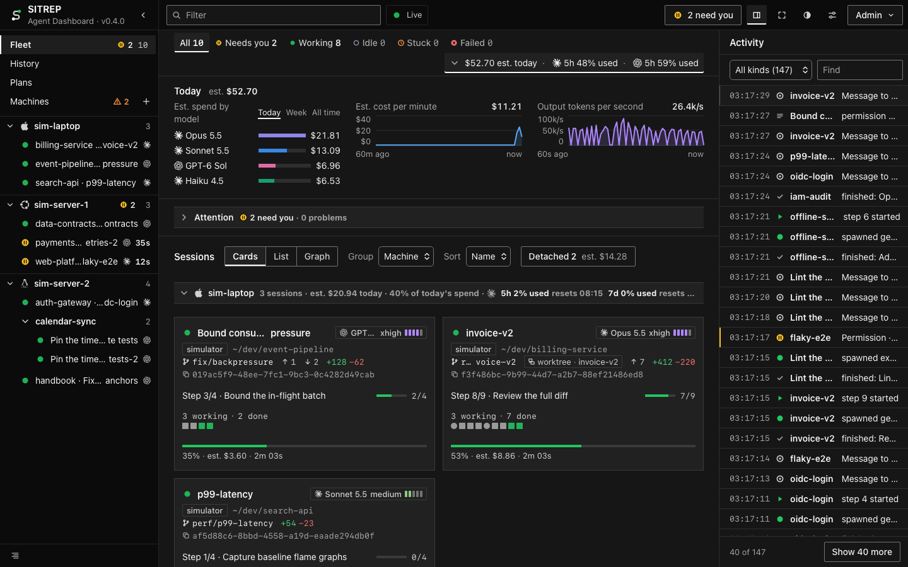
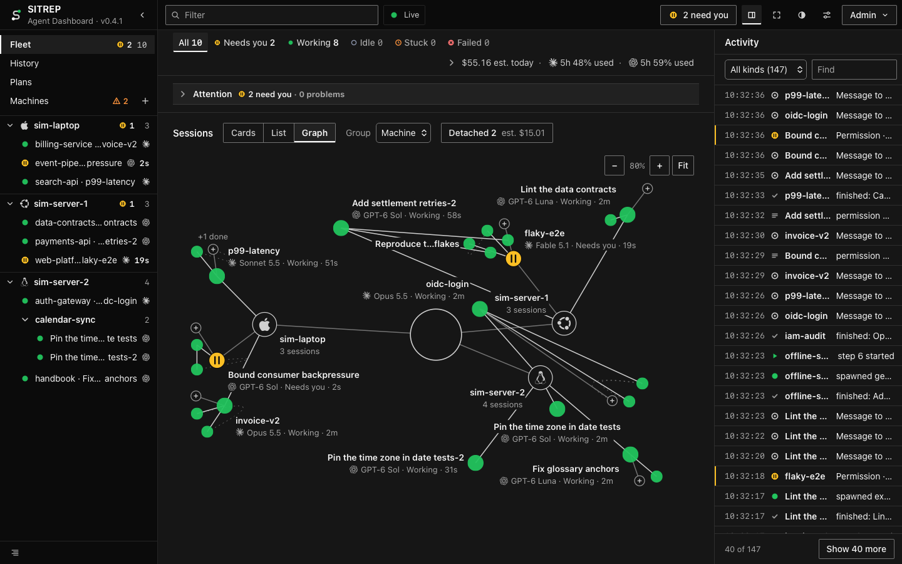
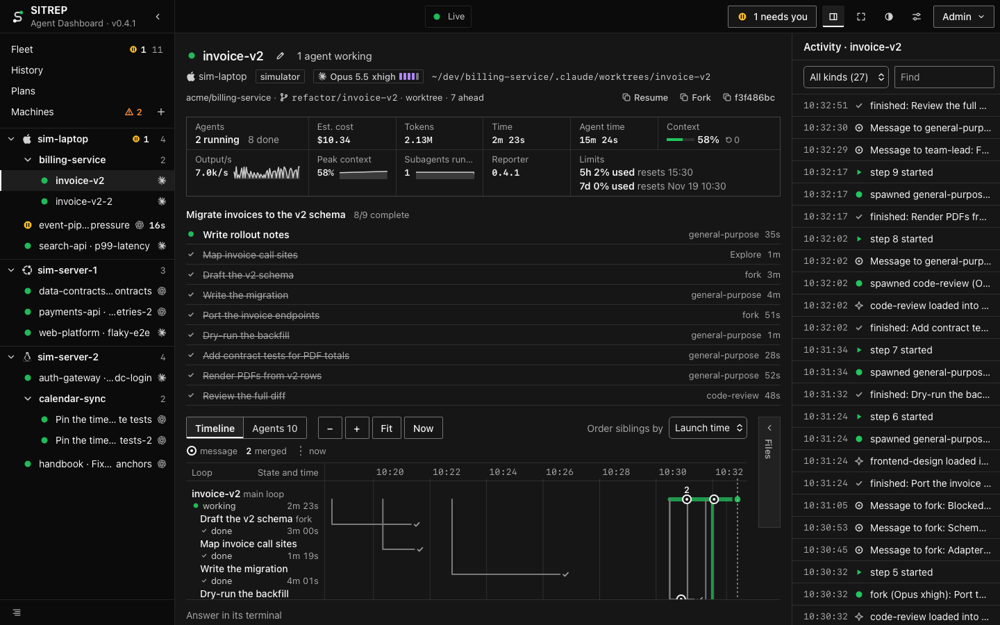
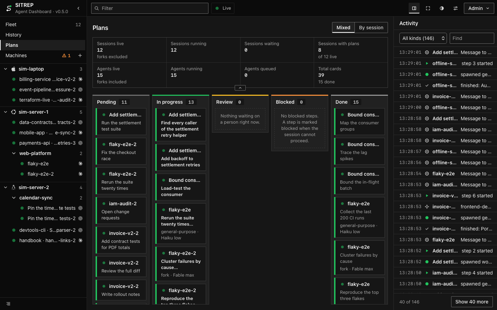
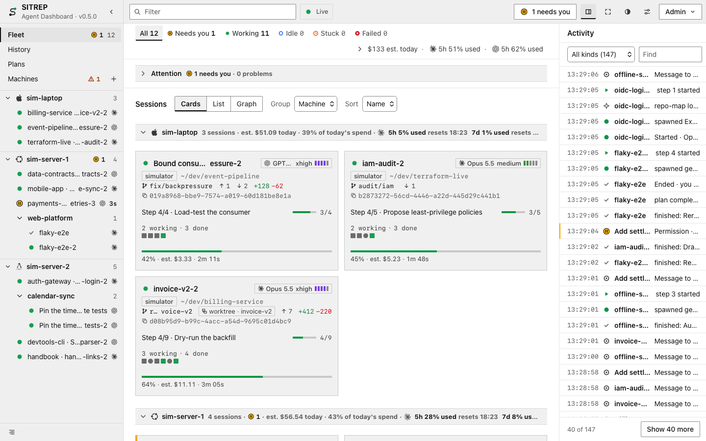

<p align="center">
  <picture>
    <source media="(prefers-color-scheme: dark)" srcset="docs/logo-dark.svg">
    
  </picture>
</p>

<h1 align="center">SITREP</h1>

<p align="center"><b>Every Claude Code and Codex session, on every machine, in one live view.</b></p>

<p align="center">
  <a href="#try-it-in-two-minutes">Try it</a> ·
  <a href="#install">Install</a> ·
  <a href="docs/TUTORIAL.md">Tour</a> ·
  <a href="docs/HOW-IT-WORKS.md">How it works</a> ·
  <a href="docs/OPERATIONS.md">Operations</a>
</p>

<p align="center">
  <a href="LICENSE"></a>
  
  
</p>

> *“Who will guard the guards themselves?”*
>
> — Juvenal, *Satires*



You run coding agents on a laptop, a workstation and a server. SITREP shows all of them at once: which are working,
which are waiting on you, which are stuck or have failed. Answer the ones that are waiting from the dashboard, without
hunting for their terminal.

| The clearest picture of a fleet of agents there is | The fastest way to unblock an agent | The safest dashboard you can point at your sessions |
|---|---|---|
| Every session on every machine as cards, a list or a graph, each with its plan and current step, its agents, model and effort, context fill, git state, cost, and what failed. | Every permission, question and plan that is waiting sits at the top, longest wait first; answer it there or in the terminal, and the first answer wins. | It sends a session only your own answers, messages and commands, never controls a terminal, never starts, stops or restarts a session, stores no transcripts, and runs on a machine you own. |

## Try it in two minutes

You need git and Node 24. A simulator stands in for the agents.

```sh
git clone https://github.com/IluvatarLabs/sitrep ~/sitrep && cd ~/sitrep
npm ci
npm run dev        # the server on :7487, the dashboard on http://localhost:5173
```

In a second terminal:

```sh
cd ~/sitrep
npx tsx scripts/sim.ts --sessions 8 --codex 0.4 --machines 3 --chaos
```

## Install

> [!WARNING]
> SITREP is built for one person on a trusted LAN. It speaks plain HTTP: anyone who can reach port 7487 can read every
> session, and answering needs a sign-in with the admin secret.
> [Security](docs/OPERATIONS.md#security-one-owner-one-secret) says how to narrow that.

### The server

On a machine that stays on:

```sh
git clone https://github.com/IluvatarLabs/sitrep ~/sitrep && cd ~/sitrep
npm ci && npm run build
npx tsx scripts/install.ts --server --bind 0.0.0.0            # dry run: prints every file and command
npx tsx scripts/install.ts --server --bind 0.0.0.0 --apply
```

It runs as a user service and writes an admin secret to `~/.sitrep/server.env`. Open `http://<server IP>:7487`. Use the
IP address: a host name has to be listed in `SITREP_ALLOWED_HOSTS` first
([Deploy the server](docs/OPERATIONS.md#deploy-the-server), step 6).

### Add a machine

On each machine that runs sessions. Machines → Add a machine in the dashboard gives these commands with your server's
address filled in:

```sh
git clone https://github.com/IluvatarLabs/sitrep ~/sitrep && cd ~/sitrep && npm ci
npm run build -w codex-reporter                               # only where Codex runs
npx tsx scripts/install.ts --claude --codex --url http://<server IP>:7487 --token-stdin --apply
```

Paste the admin secret, then Ctrl-D. Leave out `--claude` or `--codex` where that tool is not installed.
[Add a machine](docs/OPERATIONS.md#add-a-machine) has the form that pipes the secret from the server.

`npx tsx scripts/doctor.ts` checks a machine and prints the fix for anything wrong.
`npx tsx scripts/uninstall.ts --claude --codex --server` lists what it would remove, and `--apply` removes it
([Uninstall](docs/OPERATIONS.md#uninstall)). Your own hooks are never touched.

## What it looks like

| | |
|---|---|
|  |  |
|  |  |

## What it does

- **One board for every machine:** cards, a list or a graph, grouped by machine or project, filtered by state, machine,
  project or harness. [Tour](docs/TUTORIAL.md)
- **Needs you, and Problems:** what is waiting on you, and what is stuck, failed or colliding on a file.
  [What a state means](docs/HOW-IT-WORKS.md#a-session)
- **Answering:** permissions, questions and plans, plus a message, `/compact` or `/clear`.
  [How answering works](docs/HOW-IT-WORKS.md#answering)
- **Cost and limits:** estimated spend by session, model and machine, and each provider's plan window before it runs
  out. [Usage and cost](docs/HOW-IT-WORKS.md#usage-and-cost)
- **History:** ended sessions by day, with model, duration, cost and how they ended.
  [Settings and History](docs/TUTORIAL.md#settings-and-history)
- **A wall view** for a screen left on, and browser notifications when a session needs you, is stuck or fails, or a plan
  window reaches 90 %. [Filter and keys](docs/TUTORIAL.md#filter-and-keys)
- **Claude Code, Codex and Hermes.** Hermes sessions are shown, not answered. A value a harness does not report shows as
  "—", never as a guess, and every cost is marked "est.". [The pieces](docs/HOW-IT-WORKS.md#the-pieces)

## What you need

- macOS or Linux, with git. It has not been run on Windows.
- Node 24 on the server; Node 22.15 or later on every other machine (`npm ci` warns there that the repository asks for
  24, and installs anyway).
- Claude Code 2.1.287 or later.
- Codex 0.162 or later. Answering Codex sessions also needs Codex's managed daemon on that machine.
- Docker, for Hermes: its reporter is a sidecar container.

## Docs

- [Tour](docs/TUTORIAL.md): every view, with screenshots.
- [How it works](docs/HOW-IT-WORKS.md): the pieces, what a session's state means, answering, cost, what is stored.
- [Operations](docs/OPERATIONS.md): deploying, settings, security, backup, upgrades, troubleshooting.
- [Hermes](hermes-reporter/README.md): the sidecar.

## License

[MIT](LICENSE). Third-party material keeps its own license: [THIRD_PARTY_NOTICES.md](THIRD_PARTY_NOTICES.md), and
[frontend/THIRD_PARTY_NOTICES.md](frontend/THIRD_PARTY_NOTICES.md) for the logos.
