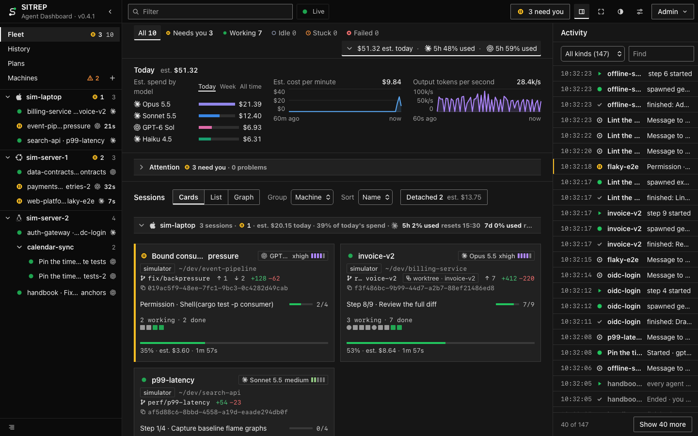
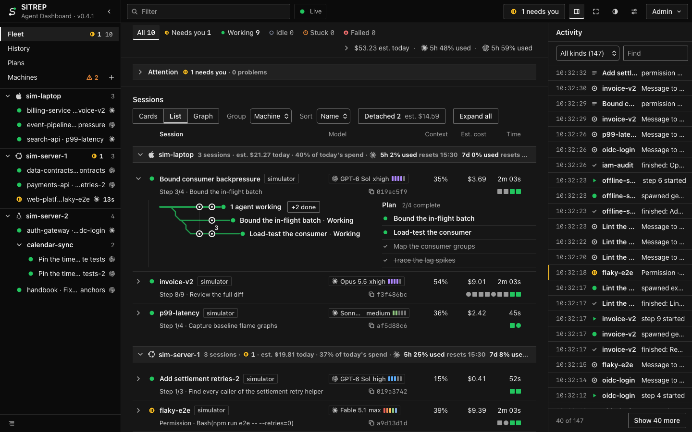
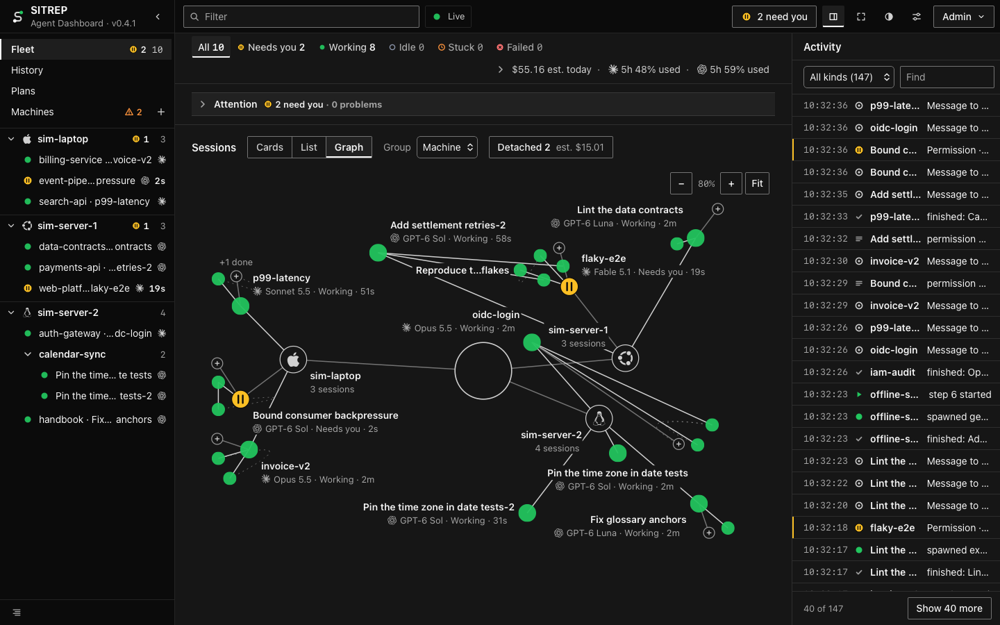
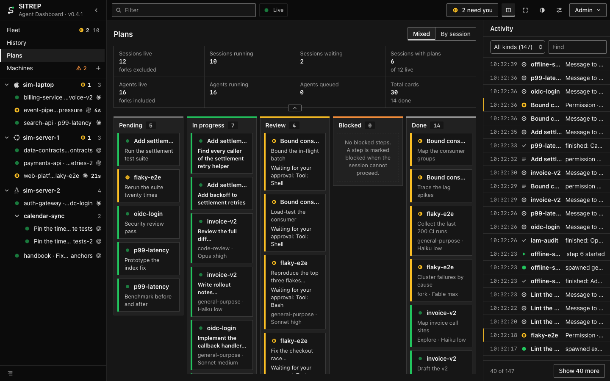
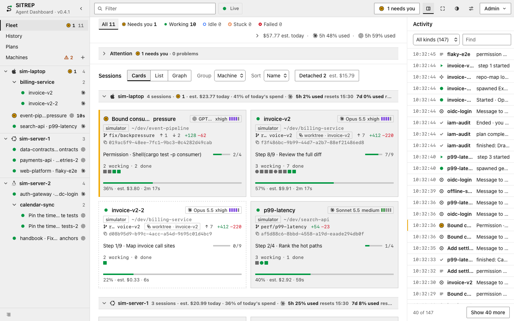
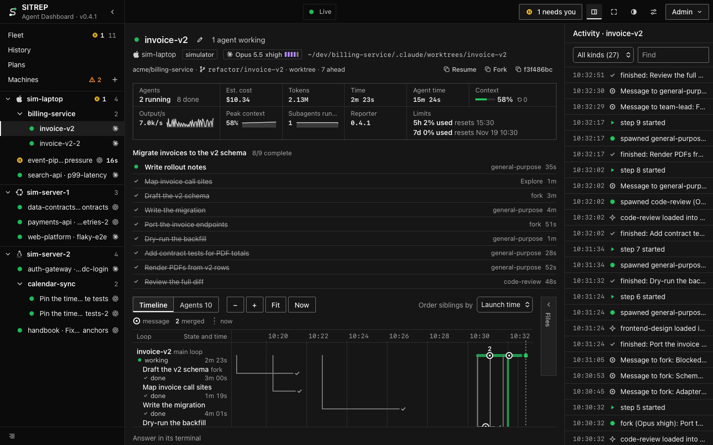
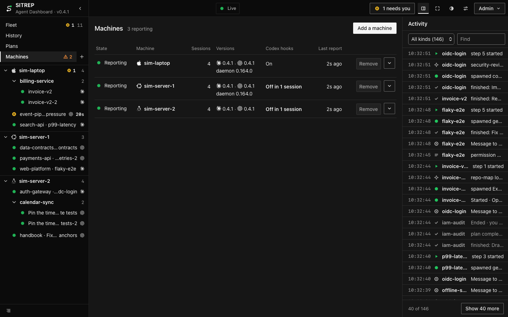
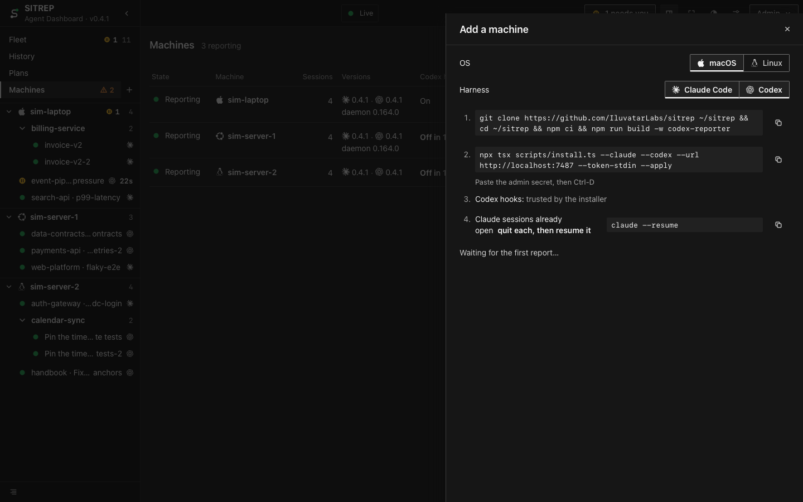
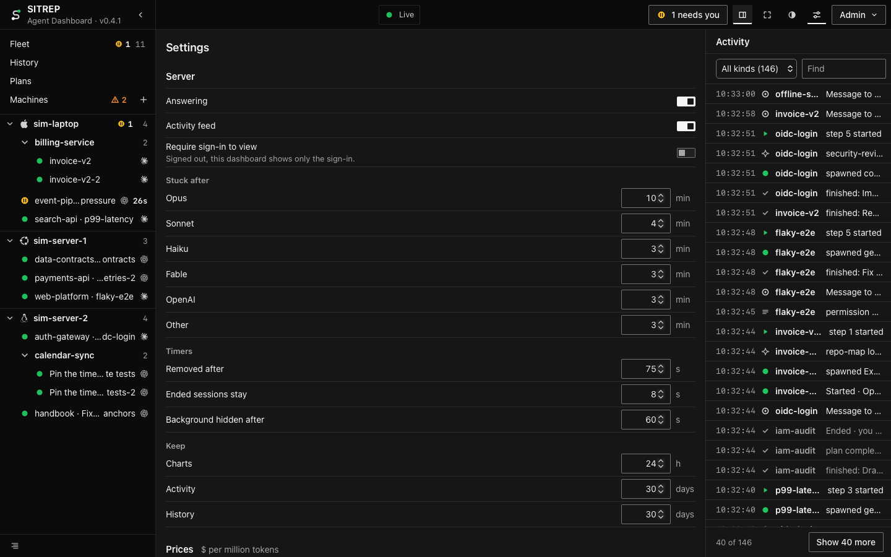
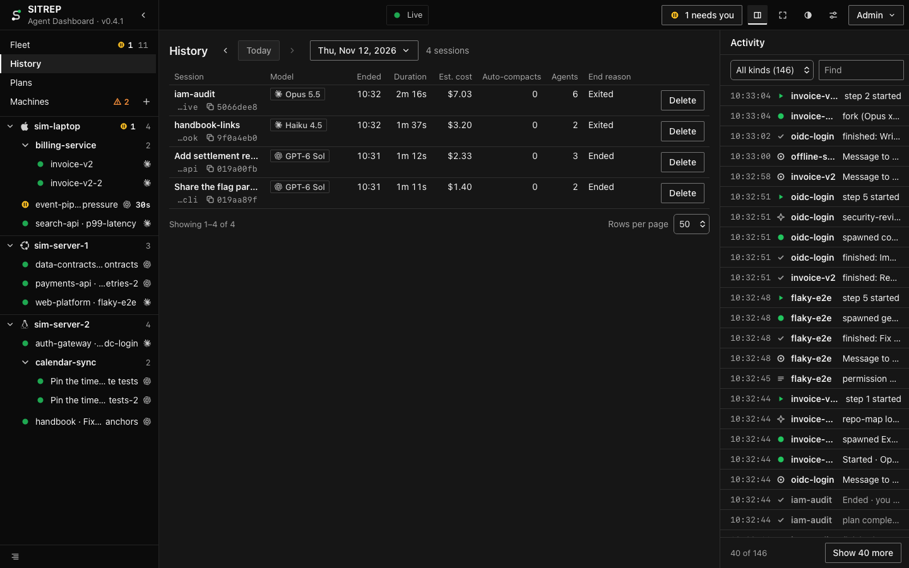

# Tutorial

A tour of the dashboard. A simulator stands in for the agents.

## Start it

```sh
npm ci
npm run dev                                   # the server on :7487, the dashboard on http://localhost:5173
```

In a second terminal, in the same folder:

```sh
npx tsx scripts/sim.ts --sessions 12 --codex 0.5 --machines 3 --seed 7
```

Add `--chaos` to make some sessions stall, fail or go silent, so every state shows up. Reading needs no sign-in. To
answer, rename or change settings, sign in (top right) with the server's admin secret. Under `npm run dev` there is one
only if a `.env` file at the repository root sets `SITREP_TOKEN`, and then the simulator needs the same variable in its
environment.

## The Fleet



The home view. At the top is a chip per state: press one to show only those sessions. At the bar's end are today's
estimated spend and each provider's plan window nearest its limit; press them for the usage panel. Headless runs and
sessions nobody is attached to sit behind a chip that counts them (**Headless**, **Detached**), shown when the fleet has
any.

The usage panel shows estimated spend by model (today, the last 7 days or all time, ended sessions included), cost per
minute and output tokens per second. It stays open or closed as you leave it. Each machine's header among the sessions
shows its own spend and plan windows, with their resets.

Next comes **Attention**, with its counts. It stays shut until you open it, and holds **Needs you** (every open
question, permission or plan, longest wait first, answerable in the row) and **Problems** (failed or stuck sessions,
stuck agents, files two sessions both edit), each in a box that scrolls.

The sidebar opens with four links: **Fleet** (every machine), History, Plans and Machines. Under Machines is every
machine with live sessions, with its projects and sessions. Press a machine to narrow the page you are on to its
sessions; press it again, or "× Show all machines", to show them all. **Details**, at the foot, is off by default. On,
it adds a second line to each sidebar row (model with its effort word and bars, plan progress, agents running) over its
context bar, and a line and a small chart to each card. Each List row gets its parts: who it delegates to, notes,
messages, shared files and tool calls, and the next step.

## Three layouts

The same sessions, laid out three ways; the choice is remembered in this browser.



**List**: one row per session. A row opens into its line of agents beside its plan; **Expand all** opens every row.



**Graph**: each machine or project as a hub, its sessions around it, their live agents around them. Press a machine's hub
to show only that machine. Zooming in shows the names and second lines left out for room. Once you zoom or pan, the view
stays where you left it until you press Fit.

## Plans



**Plans**: every session's plan steps on a board, a column per state (Pending, In progress, Review, Blocked, Done),
each card in its session's state colour. Review holds a step whose session waits on you. A card opens its session.
Sessions without a plan are not on the board.



The theme follows the system unless you pick Light or Dark in the top bar. Colour always means state: green working,
amber needs you, blue idle, orange stuck, red failed.

## A session



At the top are its state and name; machine, model and effort, path, repo and git state; and Resume, Fork and the
session id to copy. Then its facts (cost, tokens, time, context, the last minute's trends), its plan as a checklist,
and its agents as a Timeline or a tree with their files. At the foot is the message box (a message, `/clear` or
`/compact`); a session the dashboard cannot answer, like the simulator's, reads "Answer in its terminal" instead. An
open question, permission or plan shows first, with its answer.

## Machines



Each machine with its state (reporting, quiet, silent, or not seen since a restart), its sessions, its versions and
whether its Codex hooks run. A row opens to what the server refused from it ("N refused": reports and telemetry
exports) and the commands that fix them. **Remove** and **Remove silent** take machines off the dashboard.



**Add a machine** (the sidebar's "+") gives the commands to set one up, for its OS, each with Copy.

## Settings and History



Server settings (answering, the activity feed, stuck thresholds, timers, retention) apply at once. Prices shows what
each model costs, long-context lines included. This browser holds the theme, notifications, refresh rates, Animation
and the keys.



Ended sessions by day, each with its session id to copy. Each opens read-only, and Delete removes one.

## Filter and keys

The filter in the top bar matches plain words against a session's name, project, branch and machine. A prefix narrows
one field: `s:` state, `m:` machine, `p:` project, `h:` harness.

| Key | What it does |
|---|---|
| `w` | Display mode (the wall view) on or off; `Esc` leaves it |
| `[` `]` `\` | Show or hide the sidebar, Activity, the top bar |
| `l` | In display mode: the other layout |
| Arrows, `Enter` | In display mode: move between sessions, open one |
| `←` `→` `t` | In History: the day before or after, today |
