# Tour

Every view of the dashboard. A simulator stands in for the agents.

## Start it

```sh
npm ci
npm run dev                                   # the server on :7487, the dashboard on http://localhost:5173
```

In a second terminal, in the same folder:

```sh
npx tsx scripts/sim.ts --sessions 12 --codex 0.5 --machines 3 --seed 7
```

Add `--chaos` to make some sessions stall, fail or go silent, so every state shows up. Reading needs no sign-in. To
answer, rename or change settings, sign in (top right) with a name and the server's admin secret. Under `npm run dev` there is one
only if a `.env` file at the repository root sets `SITREP_TOKEN`, and then the simulator needs the same variable in its
environment. Without one there is nothing to sign in to, and what needs a sign-in is not offered.

The dashboard is a desktop page, laid out for a window 1,440 px wide or more.

## The Fleet

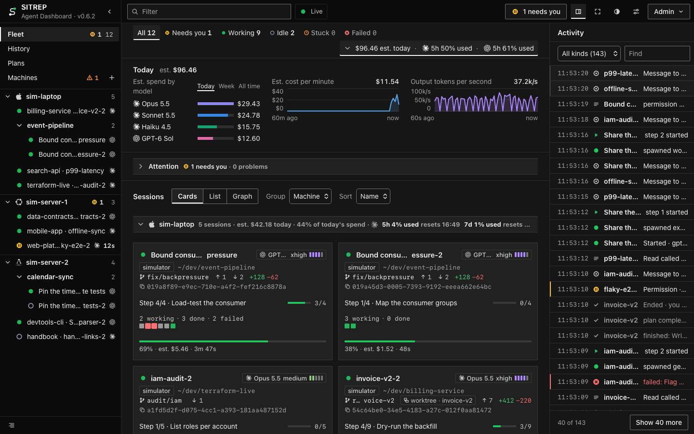

The home view. At the top is a chip per state: press one to show only those sessions. At the bar's end are today's
estimated spend and each provider's plan window nearest its limit; press them for the usage panel. Headless runs and
sessions nobody is attached to sit behind a chip that counts them (**Headless**, **Detached**), shown when the fleet has
any.

The usage panel shows estimated spend by model (today, the last 7 days or all time, ended sessions included), cost per
minute and output tokens per second. It stays open or closed as you leave it. Each machine's header among the sessions
shows its own spend and plan windows, with their resets.

Next comes **Attention**, with its counts. It stays shut until you open it, and holds **Needs you** (every open
question, permission or plan, longest wait first, answerable in the row) and **Problems** (failed or stuck sessions,
stuck agents, files two sessions both edit), each in a box that scrolls.

The sidebar opens with four links: **Fleet** (every machine), History, Plans and Machines. Under Machines is every
machine with live sessions, with its projects and sessions. Press a machine to narrow the page you are on to its
sessions; press it again, or "× Show all machines", to show them all. **Details**, at the foot, is off by default. On,
it adds a second line to each sidebar row (model with its effort word and bars, plan progress, agents running) over its
context bar, and a line and a small chart to each card. Each List row gets its parts: who it delegates to, notes,
messages, shared files and tool calls, and the next step.

## Three layouts

The same sessions, laid out three ways; the choice is remembered in this browser.

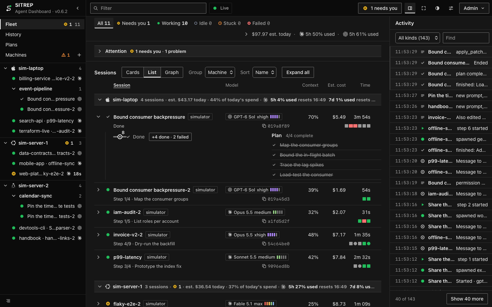

**List**: one row per session. A row opens into its line of agents beside its plan; **Expand all** opens every row.

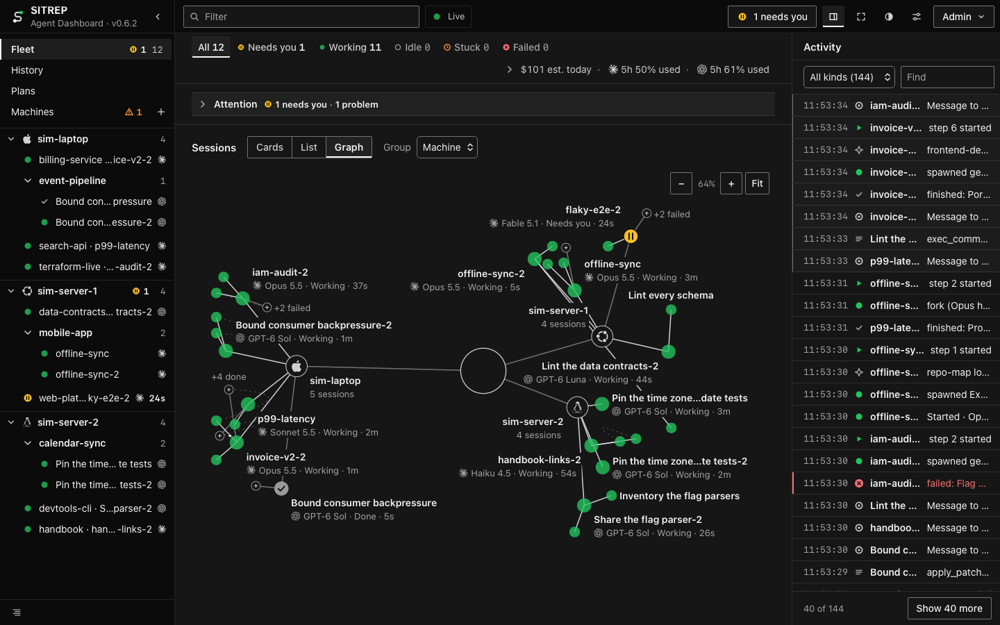

**Graph**: each machine or project as a hub, its sessions around it, their live agents around them. Press a machine's hub
to show only that machine. Zooming in shows the names and second lines left out for room. Once you zoom or pan, the view
stays where you left it until you press Fit.

## Plans

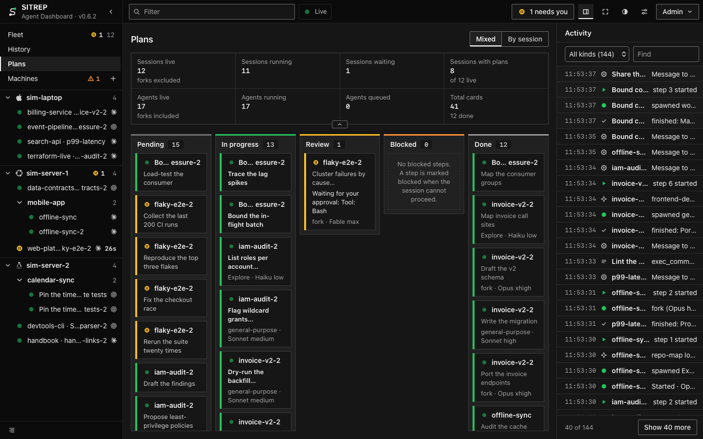

**Plans**: every session's plan steps on a board, a column per state (Pending, In progress, Review, Blocked, Done),
each card in its session's state colour. Review holds a step whose session waits on you. A card opens its session.
Sessions without a plan are not on the board.

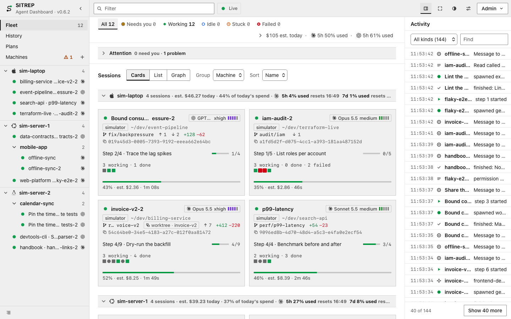

The theme follows the system unless you pick Light or Dark in the top bar. Colour always means state: green working,
amber needs you, blue idle, orange stuck, red failed.

## A session

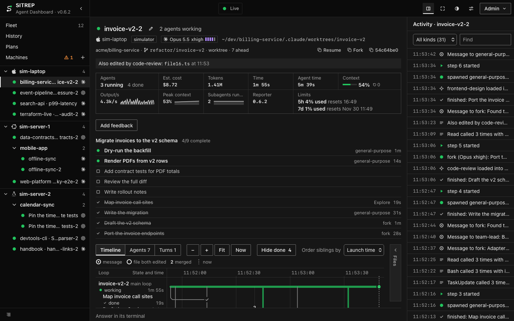

At the top are its state and name; machine, model and effort, path, repo and git state; and Resume, Fork and the
session id to copy. Then its facts (cost, tokens, time, context, the last minute's trends), its plan as a checklist,
and its agents as a Timeline or a tree with their files. **Hide done** takes the done agents off the Timeline.
At the foot is the message box (a message, `/clear` or `/compact`); a session the dashboard cannot answer, like the
simulator's, reads "Answer in its terminal" instead. An open question, permission or plan shows first, with its
answer.

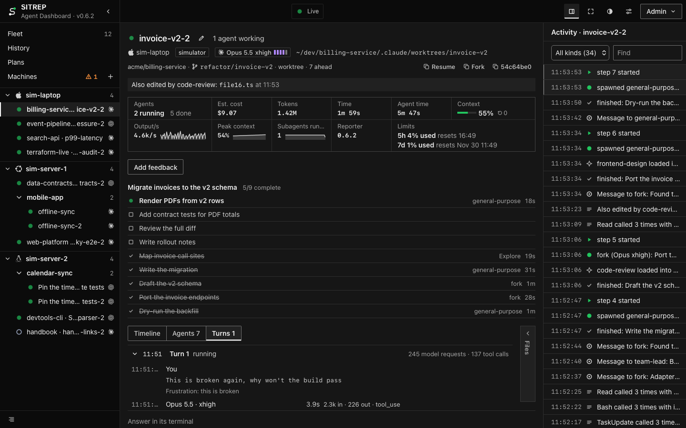

The switch over the agents has a third view, **Turns**: the session's record, newest turn first. Each turn opens to
its model requests and tool calls in order: when, how long, which model and how many tokens, how each call ended. A
kept prompt that reads as frustration, or as a correction after the session's first turn, is marked so, with the words that
matched. A
row opens to its detail and its feedback, and a failed call links to its issue. On a machine set to full capture a
row also has its text, shown signed in ([The record](OPERATIONS.md#the-record)).

Signed in, **Add feedback** puts a tag, a score or a value, and a comment on the session or on one row. While a
session needs someone, **Claim** tells everyone "Claimed by" and your name; it restricts nothing.

## Machines

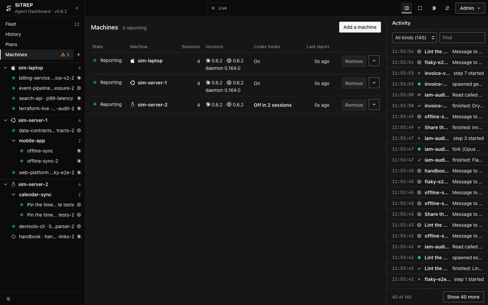

Each machine with its state (reporting, quiet, silent, or not seen since a restart), its sessions, its versions and
whether its Codex hooks run. A row opens to what the server refused from it ("N refused": reports and telemetry
exports) and the commands that fix them. **Remove** and **Remove silent** take machines off the dashboard.

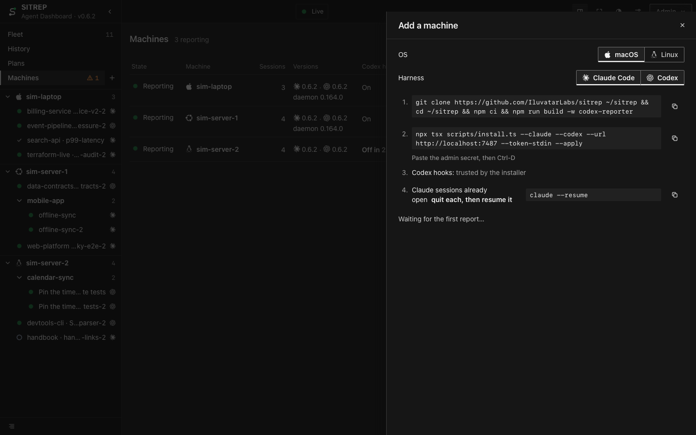

**Add a machine** (the sidebar's "+") gives the commands to set one up, for its OS, each with Copy.

## Settings

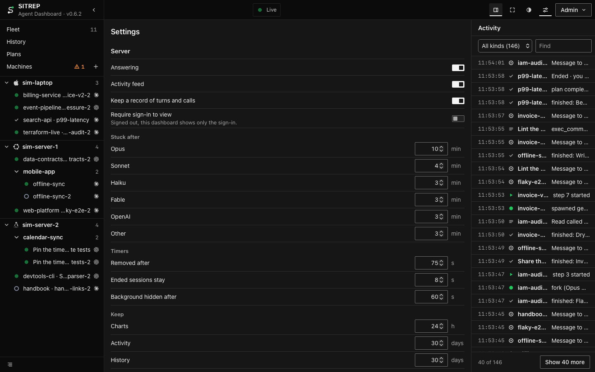

Server settings (answering, the activity feed, the record of turns and calls, stuck thresholds, timers, retention)
apply at once. Prices shows what each model costs, long-context and fast-mode lines included. This browser holds the
theme, notifications, refresh rates, Animation and the keys.

## History

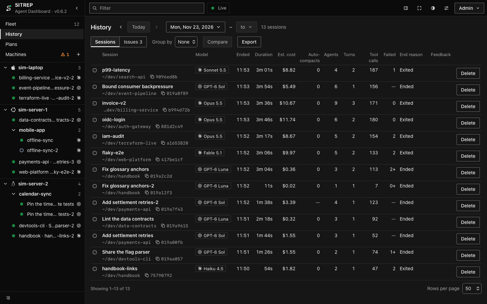

Ended sessions by day, or over a range of days when you set the second date. Each has its session id to copy, its
turns, tool calls and failed calls, and your feedback. Each opens read-only, and Delete removes one.

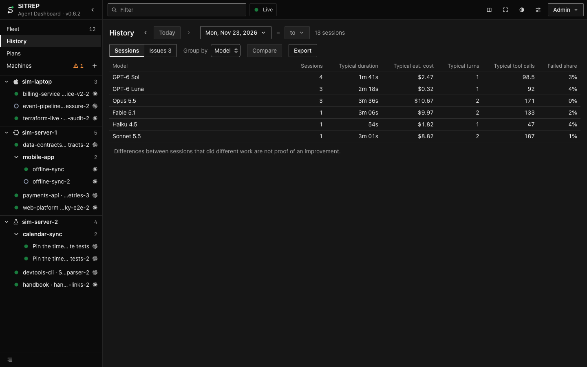

**Group by** turns the list into one row a group (day, week, model, harness version, project, machine or feedback)
with its sessions, typical duration, cost, turns and tool calls, and the share of calls that failed.

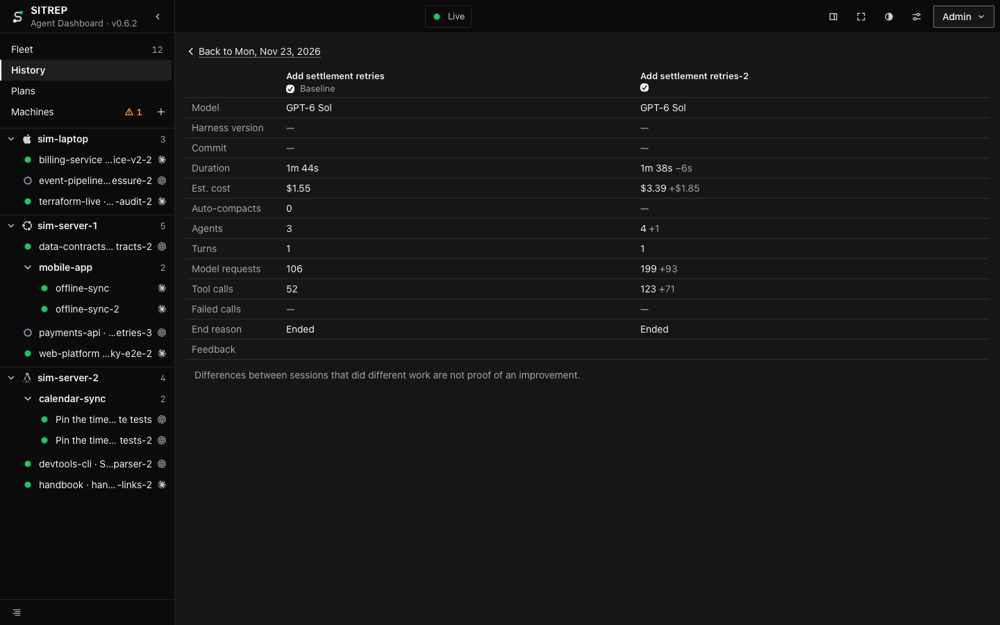

**Compare:** tick two or more sessions and they are set side by side, the first ticked as the baseline, each other one
with its difference from it.

**Search:** the top bar's filter narrows the list, and its plain words search each session's name, its Activity, its
agents' prompts, answers and failures and, signed in, its kept text. A match outside the name shows under it, and one
in kept text opens the session at that row.

**Export**, signed in, downloads every session in the range and filter, with its record and feedback, as JSONL.

## Issues

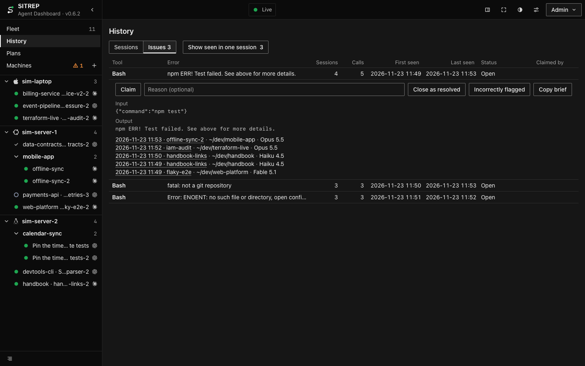

History's second view. The same error failing a tool call in two or more sessions is one issue, listed with its tool,
its sessions and calls, and when it was first and last seen; the open ones come first, and one control adds the
closed ones, another those seen in a single session. An issue opens to its newest kept input and output, where you may
read kept text, and its occurrences, each a link to the failing call. Signed in you can claim it, close it as resolved or as incorrectly flagged with a reason, and reopen it; one
closed as resolved opens again by itself if the error comes back. **Copy brief** copies the issue as Markdown, to hand
to an agent.

## Filter and keys

The filter in the top bar matches plain words against a session's name, project, branch and machine. A prefix narrows
one field: `s:` state, `m:` machine, `p:` project, `h:` harness. On History `s:` does nothing (every session there has
ended), and the field also takes `model:`, `tool:`, `end:` (how a session ended) and `fb:` (a feedback tag).

| Key | What it does |
|---|---|
| `w` | Display mode (the wall view) on or off; `Esc` leaves it |
| `[` `]` `\` | Show or hide the sidebar, Activity, the top bar |
| `l` | In display mode: the other layout |
| Arrows, `Enter` | In display mode: move between sessions, open one |
| `←` `→` `t` | In History: the day before or after, today |
